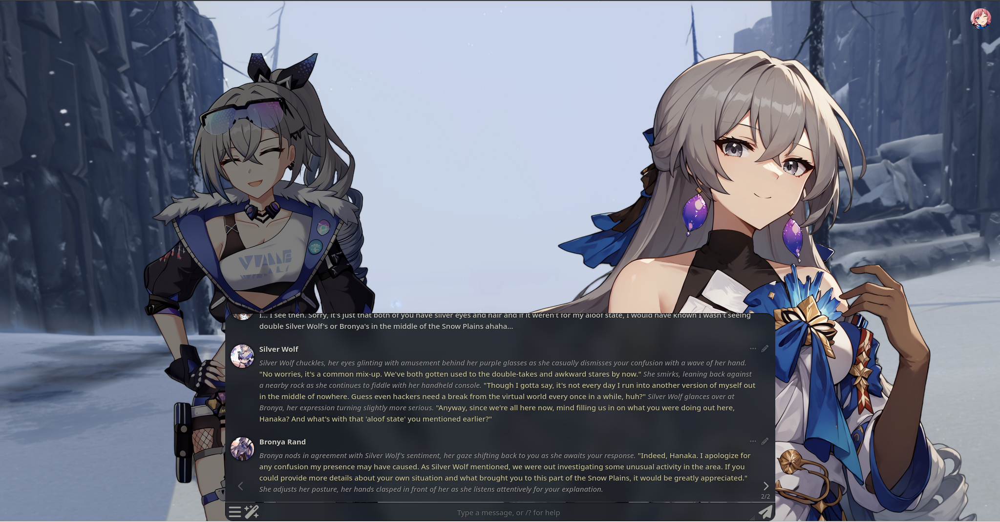
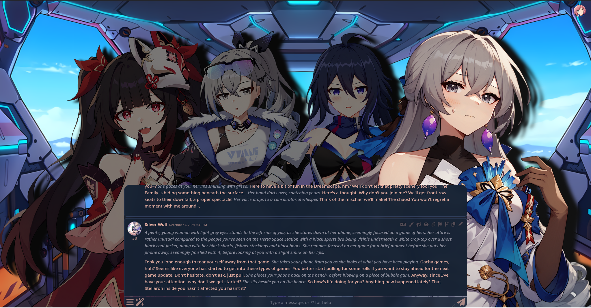
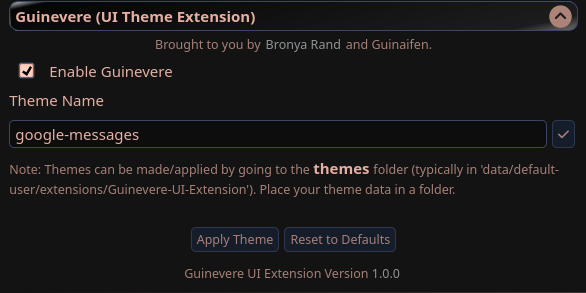

# Guinevere UI Extension

The Guinevere UI Extension is a massive extension for SillyTavern that basically makes SillyTavern *your* way outside of Custom CSS. Guinevere has the support of multiple theme packs that can either be simple HTML, CSS, or JavaScript code to massive overhauls of the ST UI that no one has ever fathom before. A frontend designer's dream canvas for AI.

## Why Guinevere?

> Guinaifen: That's my actual name! I just thought this little project of ours needed a little spazz~. Hey, that sounded pretty good!

## Features

1. A complete overhaul of SillyTavern's original UI with one click of a button.
    > To put it briefly, SillyTavern's UI hasn't really aged well for some folk, especially those who either come from a AI website like C.AI or were using TavernAI, MikuPad, etc. (Trust me. I was on the same boat for a while). Well rest easy now that you have full control of the UI with whatever placement, icons, images you wish to add whether it be mimicking a existing UI or making one from scratch!

    <p align="center">
        
    </p>
2. Existing Compatability with ST Custom Themes 
    > Just because this is an overhaul, doesn't mean those old CSS lines from the ST Discord are all dead. Heck, you can still use these themes as-if nothing happened\* with Guinevere.

    <p align="center">
        
        <br>
        <em>Group Chat using the Celestial Macaron theme</em>
    </p>

    > \* - Some Guinevere themes may use different class elements or use fixed colors that some themes will not be able to apply over. 

3. Support for several themes.

4. Support for ST's Custom CSS.
    > Even though Guinevere is basically a DIY platform and doesn't really need ST's "Custom CSS" code, it is still usable :) Enjoy.
5. Open-Freedom to make anything you want.
    > Whether you want to mimic OpenAI, a UI scheme from a miHoYo game or whatnot, as long as you have a HTML, CSS and JS companion with you (Sakana: That's me!), you can build practically anything you want.

Guinevere Settings can be found under _Extensions_ > `Guinevere (UI Theme Extension)`. Be mindful that the `Extensions` icon can change depending on the theme you use and might not exactly portray the ST defaults.

<p align="center">
    
    <br>
</p>

## Prerequisites

A modern version of SillyTavern with the **(optional)** Guinevere Theme Installer server plugin installed (see [Server Plugin](#server-plugin-guinevere-theme-installer)).

## Installation

### Server Plugin (Guinevere-Theme-Installer)
```bash
cd plugins
git clone https://github.com/Bronya-Rand/Guinevere-Theme-Installer
```

### UI Plugin (Guinevere-UI-Extension)

#### Via Download Extensions & Assets (Easiest)

1. Click _Extensions_ then **Download Extensions & Assets**
2. Click the red power plug button and then OK.
3. Scroll down to find `Guinevere UI Extension` and click the Download button.
4. Refresh the SillyTavern page.
5. Click on _Extensions_ again and click down on the `Guinevere (UI Theme Extension)` dropdown and toggle _Enable Guinevere_.
6. Choose **Google Messages (Legacy)** from the **Theme** dropdown.
7. Click **Apply Theme**.
8. To install additional theme packs, see [Theme ZIP import](#theme-zip-import).

#### Via Install Extension

1. Click _Extensions_ then **Install Extension**
2. Paste in the following **link** into the text field and click Save: `https://github.com/Bronya-Rand/Guinevere-UI-Extension`.
3. Refresh the SillyTavern page.
4. Click on _Extensions_ again and click down on the `Guinevere (UI Theme Extension)` dropdown and toggle _Enable Guinevere_.
5. Choose **Google Messages (Legacy)** from the **Theme** dropdown.
6. Click **Apply Theme**.
7. To install additional theme packs, see [Theme ZIP import](#theme-zip-import).

## Theme ZIP import

**Import Theme ZIP** installs theme packs on the ST server through the optional [Guinevere Theme Installer](server-plugin/README.md). Install the plugin following the steps [here](#server-plugin-guinevere-theme-installer), set `enableServerPlugins` to *true* in your `config.yaml` file, restart ST, and click **Refresh Themes**. Guinevere must be installed for each current user to import packs; global-only installations can use the dropdown but need a regular per-user installation of Guinevere for uploads.

After setup, choose a ZIP file with **Import Theme ZIP**. Guinevere validates and installs it, refreshes the dropdown, and selects the new theme. Enable Guinevere and click **Apply Theme** to activate it. Existing themes are not overwritten, and importing does not execute theme code.

The dropdown shows human-readable theme names. Without the server plugin, it uses `themes/registry.json` plus any existing saved theme selection. With the plugin, it also discovers theme folders in the current user's and global Guinevere installations. For bundled themes, add their folder IDs to the registry when shipping them. See the [pack format and setup instructions](server-plugin/README.md) for ZIP structure, stable theme IDs, and supported limits.

> [!NOTE]
> If you wish not to use Guinevere Theme Installer, simply extract the theme's ZIP file into `data/<USER>/extensions/Guinevere-UI-Extension/themes`. Then edit `registry.json` to add the name of the theme's folder into the themes list.

## Google Messages

The new **Google Messages** theme is available in the dropdown alongside Legacy. Its first slice adds responsive navigation, a native settings workspace, persona switching, and saved appearance preferences while retaining ST's existing chat and composer. See [the theme's current scope](themes/google-messages/README.md) for features included now and upcoming conversation/VN work. Existing saved selections remain on Legacy.

## Google Messages (Legacy)

The original Google-style profile popover and settings modal are preserved as **Google Messages (Legacy)** in `themes/google-messages-legacy`. Selections saved before the rename migrate automatically to Legacy once, with a notification. New selections of **Google Messages** use the new theme; Legacy remains independently selectable.

The extension waits for SillyTavern to finish initializing before applying an enabled theme. Apply/reset operations run in sequence. If a theme fails to load, Guinevere removes its partial changes after calling its cleanup function. A theme whose cleanup fails is retained so its ST controls are not deleted; refresh before trying another theme.

## Creating your own theme for Guinevere

Themes can use [shared session helpers](helpers/README.md) for panel movement, event and timer cleanup, reversible changes, persistent options per theme, and colors inherited from ST. The loader passes the session to `execute(theme)` and disposes it before removing theme assets. The original zero-argument theme interface remains supported.

See the `template` folder in your Guinevere's theme folder as a starter to make your own theme! Just make sure to adhere to these points:

1. If you plan to share your theme, make sure your theme works for mobile users! Or at least state this is mostly a Desktop designed theme. People may install your theme and wonder why it looks jank on their end. Use different monitors, devices, etc.
2. Preferably use CSS that exists in ST already! People may want to apply a UI theme over yours! Be grateful people will use your theme and allow others to style it more their way too!
3. Do not change any of Guinevere's code lines unless you *know* what you're doing. To put it frank, the internals are only needed to work the execution of stuff on the frontend side. All your code should go into your themes folder. JS code should be executed using a `code.js` file.
4. Make sure you test your theme rigurously. Especially when it comes to resetting. People are gonna wonder why your theme breaks other themes if you don't reset it properly and not recommend it.
5. Don't be a dolt. Just do this for fun and not of malice.

Refer to exisitng HTML/CSS/JS on the internet and the Google Messages (Legacy) theme as references to make your first Guinevere theme.

The Guinevere UI Extension, the Guinevere UI Extension Code, Copyright 2025 Bronya-Rand. All rights reserved.
